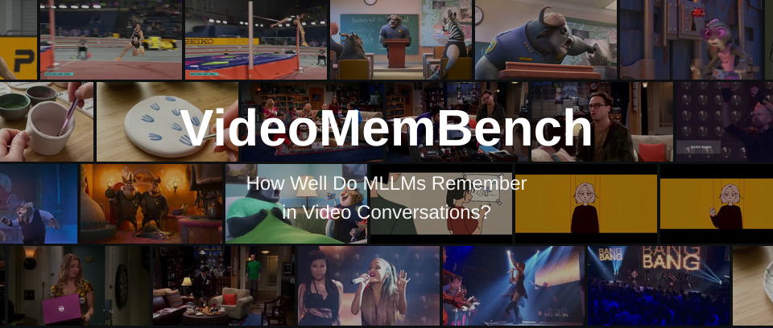

<div align="center">
  

  <p>Zhengdong Hu<sup>1,*</sup> &nbsp; Chao Wang<sup>1,*</sup> &nbsp; Kaituo Feng<sup>2</sup> &nbsp; Huanjin Yao<sup>3</sup> &nbsp; Mingfei Lu<sup>1</sup> &nbsp; Hehe Fan<sup>4</sup> &nbsp; Yi Yang<sup>4,†</sup></p>
  <p><sup>1</sup> University of Technology Sydney &nbsp; · &nbsp; <sup>2</sup> The Chinese University of Hong Kong<br/>
  <sup>3</sup> The Hong Kong University of Science and Technology &nbsp; · &nbsp; <sup>4</sup> Zhejiang University</p>
  <p><sup>*</sup> Equal contribution &nbsp; · &nbsp; <sup>†</sup> Corresponding author</p>


  
  <p>
    <a href="https://videomembench.github.io/">
       Project
    </a>
    &nbsp; · &nbsp;
     Paper <sub>Coming soon</sub>
    &nbsp; · &nbsp;
    <a href="https://huggingface.co/datasets/VideoMemBench/data">
     Dataset
    </a>
    &nbsp; · &nbsp;
    <a href="#results">
       Leaderboard
    </a>
  </p>


[Overview](#overview) · [Evaluation](#evaluation) · [Protocol](docs/PROTOCOL.md) · [Data Format](docs/DATA_FORMAT.md) · [Results](#results) · [Citation](#citation)

</div>

---

## Overview


**VideoMemBench** evaluates in-context video memory in multi-turn video conversations.
Later questions depend on earlier turns through two types of links: **Episodic
Dependencies**, which revisit a previously discussed scene or entity, and **Answer
Dependencies**, which build on an earlier answer.

Each model receives the same **128 timestamped frames**. Questions are presented
in dialogue order, with the model's own previous responses retained in the history.

## Results

Main results across current LLMs. All 25 models use 128 fixed frames and sequential
self-rollout. Scores are percentages; higher is better. Rows are ranked by Overall.

| Rank | Model | TurnAcc | EpiDepAcc | AnsDepAcc | Overall ↑ |
| ---: | :--- | ---: | ---: | ---: | ---: |
| 1 | &nbsp; Claude Opus 5 | 52.3 | 49.1 | 35.7 | 45.7 |
| 2 | &nbsp; Gemini 3.8 Flash | 50.4 | 46.6 | 30.3 | 42.4 |
| 3 | &nbsp; Kimi K3 | 50.5 | 49.0 | 27.1 | 42.2 |
| 4 | &nbsp; GPT-5.6-sol | 50.0 | 47.8 | 27.1 | 41.7 |
| 5 | &nbsp; Gemini 3.5 Flash | 49.6 | 45.5 | 29.7 | 41.6 |

<details>
<summary><b>Full results — 25 models</b></summary>

| Rank | Model | TurnAcc | EpiDepAcc | AnsDepAcc | Overall ↑ |
| ---: | :--- | ---: | ---: | ---: | ---: |
| 1 | &nbsp; Claude Opus 5 | 52.3 | 49.1 | 35.7 | 45.7 |
| 2 | &nbsp; Gemini 3.8 Flash | 50.4 | 46.6 | 30.3 | 42.4 |
| 3 | &nbsp; Kimi K3 | 50.5 | 49.0 | 27.1 | 42.2 |
| 4 | &nbsp; GPT-5.6-sol | 50.0 | 47.8 | 27.1 | 41.7 |
| 5 | &nbsp; Gemini 3.5 Flash | 49.6 | 45.5 | 29.7 | 41.6 |
| 6 | &nbsp; GPT-5.5 | 48.0 | 46.5 | 27.0 | 40.5 |
| 7 | &nbsp; Claude Sonnet 5 | 47.8 | 45.3 | 27.3 | 40.2 |
| 8 | &nbsp; Gemini 3.1 Pro Preview | 45.7 | 44.8 | 27.0 | 39.1 |
| 9 | &nbsp; GPT-5.4 | 44.4 | 42.6 | 21.9 | 36.3 |
| 10 | &nbsp; Qwen3-VL-235B-A22B | 43.1 | 41.6 | 18.6 | 34.4 |
| 11 | &nbsp; Qwen3.5-27B | 42.2 | 39.8 | 20.9 | 34.3 |
| 12 | &nbsp; Qwen3.5-397B-A17B | 42.3 | 40.1 | 20.3 | 34.2 |
| 13 | &nbsp; Qwen3.5-122B-A10B | 42.4 | 39.5 | 19.9 | 33.9 |
| 14 | &nbsp; Qwen3.5-35B-A3B | 38.2 | 36.3 | 18.0 | 30.8 |
| 15 | &nbsp; Qwen3-VL-32B | 39.3 | 35.9 | 17.2 | 30.8 |
| 16 | &nbsp; Qwen3-VL-30B-A3B | 36.4 | 35.1 | 15.8 | 29.1 |
| 17 | &nbsp; Qwen3.5-9B | 34.6 | 33.4 | 12.9 | 27.0 |
| 18 | &nbsp; Qwen3-VL-8B | 34.8 | 32.1 | 12.3 | 26.4 |
| 19 | &nbsp; Qwen3.5-4B | 33.8 | 32.6 | 12.5 | 26.3 |
| 20 | &nbsp; Qwen3-VL-4B | 32.4 | 29.4 | 12.9 | 24.9 |
| 21 | &nbsp; Qwen2.5-VL-32B | 31.7 | 32.6 | 9.6 | 24.6 |
| 22 | &nbsp; Qwen2.5-VL-7B | 26.2 | 24.9 | 8.4 | 19.8 |
| 23 | &nbsp; Keye-VL-1.5-8B | 25.4 | 24.5 | 8.2 | 19.4 |
| 24 | &nbsp; Qwen2.5-VL-3B | 23.5 | 24.4 | 5.7 | 17.9 |
| 25 | &nbsp; Qwen3.5-0.8B | 21.6 | 21.3 | 5.7 | 16.2 |

</details>

### Frame-count comparison

Table 4 evaluates 13 open-weight models with 64 or 32 uniformly sampled frames per
video, using the same self-rollout protocol and scoring rules as the 128-frame
results. Scores are percentages; higher is better.

<details>
<summary><b>64 frames — 13 models</b></summary>

| Rank | Model | TurnAcc | EpiDepAcc | AnsDepAcc | Overall ↑ |
| ---: | :--- | ---: | ---: | ---: | ---: |
| 1 | &nbsp; Qwen3-VL-235B-A22B | 40.3 | 39.3 | 15.6 | 31.7 |
| 2 | &nbsp; Qwen3.5-122B-A10B | 37.8 | 36.5 | 15.2 | 29.8 |
| 3 | &nbsp; Qwen3.5-27B | 37.9 | 36.7 | 14.8 | 29.8 |
| 4 | &nbsp; Qwen3-VL-32B | 37.8 | 36.1 | 14.5 | 29.5 |
| 5 | &nbsp; Qwen3.5-35B-A3B | 37.0 | 36.7 | 13.5 | 29.1 |
| 6 | &nbsp; Qwen3-VL-30B-A3B | 33.6 | 32.9 | 11.5 | 26.0 |
| 7 | &nbsp; Qwen3-VL-8B | 32.7 | 32.0 | 11.9 | 25.5 |
| 8 | &nbsp; Qwen3.5-9B | 33.4 | 33.2 | 9.6 | 25.4 |
| 9 | &nbsp; Qwen3-VL-4B | 31.3 | 30.3 | 12.1 | 24.5 |
| 10 | &nbsp; Keye-VL-1.5-8B | 24.5 | 24.9 | 6.3 | 18.5 |
| 11 | &nbsp; Qwen2.5-VL-7B | 24.1 | 22.7 | 6.4 | 17.7 |
| 12 | &nbsp; Qwen2.5-VL-3B | 22.5 | 22.5 | 5.1 | 16.7 |
| 13 | &nbsp; Qwen3.5-0.8B | 21.0 | 21.1 | 4.7 | 15.6 |

</details>

<details>
<summary><b>32 frames — 13 models</b></summary>

| Rank | Model | TurnAcc | EpiDepAcc | AnsDepAcc | Overall ↑ |
| ---: | :--- | ---: | ---: | ---: | ---: |
| 1 | &nbsp; Qwen3-VL-235B-A22B | 36.3 | 37.8 | 14.5 | 29.5 |
| 2 | &nbsp; Qwen3.5-122B-A10B | 35.0 | 35.2 | 10.7 | 27.0 |
| 3 | &nbsp; Qwen3.5-35B-A3B | 34.5 | 34.1 | 12.3 | 27.0 |
| 4 | &nbsp; Qwen3.5-27B | 34.9 | 34.2 | 11.7 | 26.9 |
| 5 | &nbsp; Qwen3-VL-32B | 34.1 | 32.6 | 13.1 | 26.6 |
| 6 | &nbsp; Qwen3-VL-30B-A3B | 32.1 | 32.5 | 8.0 | 24.2 |
| 7 | &nbsp; Qwen3.5-9B | 29.8 | 30.4 | 8.6 | 22.9 |
| 8 | &nbsp; Qwen3-VL-8B | 29.4 | 29.4 | 9.2 | 22.7 |
| 9 | &nbsp; Qwen3-VL-4B | 29.0 | 29.0 | 8.8 | 22.3 |
| 10 | &nbsp; Qwen2.5-VL-7B | 23.2 | 23.7 | 4.9 | 17.3 |
| 11 | &nbsp; Keye-VL-1.5-8B | 23.3 | 23.1 | 5.1 | 17.2 |
| 12 | &nbsp; Qwen2.5-VL-3B | 22.6 | 23.4 | 4.7 | 16.9 |
| 13 | &nbsp; Qwen3.5-0.8B | 20.1 | 21.8 | 4.7 | 15.5 |

</details>

We will continue evaluating new models and updating this leaderboard.

## Evaluation

<p align="center">
  
</p>

### Installation

Python 3.11 or newer is required.

```bash
python -m venv .venv
source .venv/bin/activate
pip install -e .
```

### Data

Place annotations and videos under `data/`:

```text
data/
├── annotations.jsonl
└── videos/
    └── <video_name>.mp4
```

See [Data Format](docs/DATA_FORMAT.md) for the annotation schema.

### Prepare frames

```bash
python -m videomembench.data data/annotations.jsonl
python -m videomembench.video \
  --annotations data/annotations.jsonl \
  --video-root data/videos \
  --frame-cache cache/f128
```

Reuse the same frame cache across all models. The cache records frame indices,
timestamps, and checksums to keep visual input fixed.

### Run inference

Set model and judge endpoints in [`configs/evaluation.toml`](configs/evaluation.toml).
The main evaluation uses **GPT-5.4 mini** for open-answer grading. Set the model ID
exposed by your endpoint and provide credentials through environment variables:

```bash
export VMB_API_KEY="your-model-api-key"
export VMB_JUDGE_API_KEY="your-judge-api-key"

python -m inference.evaluate --config configs/evaluation.toml
```

For unauthenticated local endpoints, leave the corresponding key variable unset.
The vision endpoint must support 128 images and the complete dialogue history.
Use `--workers N` to evaluate videos concurrently; turns within each video remain
sequential. Repeating a run skips completed videos and retries failed dialogues.
Use a new output path when changing the model or evaluation settings.

### Compute scores

```bash
python -m inference.metrics \
  --annotations data/annotations.jsonl runs/my-model/eval.jsonl

python -m inference.metrics \
  --annotations data/annotations.jsonl \
  --format json runs/my-model/eval.jsonl > runs/my-model/metrics.json
```

Reports are available in Markdown, JSON, and CSV. Incomplete runs are rejected by
default. `--allow-incomplete` reports diagnostic scores with missing turns counted
as incorrect.

## Metrics

<table>
<thead><tr><th align="left">Metric</th><th align="left">Evaluation subset</th><th align="left">Credit rule</th></tr></thead>
<tbody>
<tr><td><b>①&nbsp;TurnAcc</b></td><td>All turns</td><td>Correct current response</td></tr>
<tr><td><b>②&nbsp;EpiDepAcc</b></td><td>≥1 Episodic parent</td><td>Correct current response; independent of parent correctness</td></tr>
<tr><td><b>③&nbsp;AnsDepAcc</b></td><td>≥1 Answer parent</td><td>Correct current response and all recursive Answer ancestors</td></tr>
<tr><td><b>Overall</b></td><td>Three complementary metrics</td><td><b>(① + ② + ③) / 3</b></td></tr>
</tbody>
</table>

Answer-ancestor traversal follows **Answer edges only**. Episodic edges are excluded
at every depth. A turn with both dependency types contributes to both subsets.
Scores are pooled across turns and reported as percentages.

See [Evaluation Protocol](docs/PROTOCOL.md) for frame sampling, response grading,
and metric definitions.

## Examples and Tests

The [example files](examples/) illustrate the annotation format and dependency
scoring. They are synthetic examples, not benchmark samples.

```bash
pip install -e ".[dev]"
python -m videomembench.data examples/annotations.jsonl
python -m inference.metrics \
  --annotations examples/annotations.jsonl examples/results.jsonl
python -m pytest
```

The example scores are TurnAcc **75.00**, EpiDepAcc **100.00**, AnsDepAcc **0.00**,
and Overall **58.33**.

## Citation

```bibtex
@unpublished{videomembench,
  title  = {VideoMemBench: How Well Do MLLMs Remember in Video Conversations?},
  author = {Hu, Zhengdong and Wang, Chao and Feng, Kaituo and Yao, Huanjin
            and Lu, Mingfei and Fan, Hehe and Yang, Yi},
  note   = {Manuscript}
}
```

## License

VideoMemBench is available for **academic, non-commercial research**. Commercial
use and redistribution require prior written permission. Copyright in source videos
remains with their respective owners. See [LICENSE](LICENSE) for the full terms.
