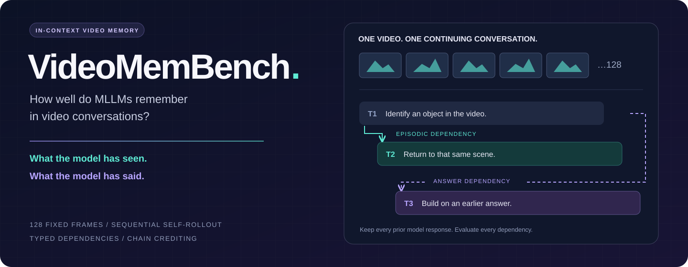
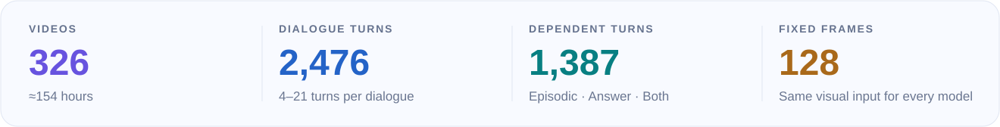
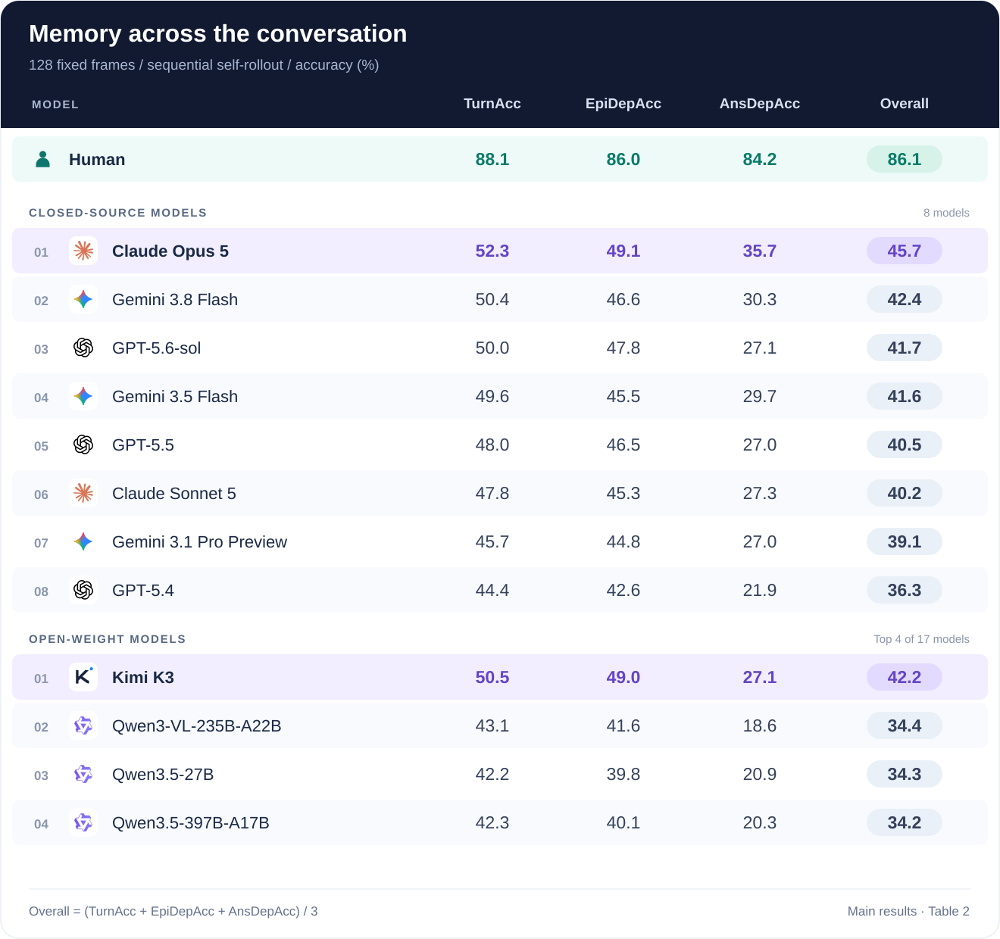
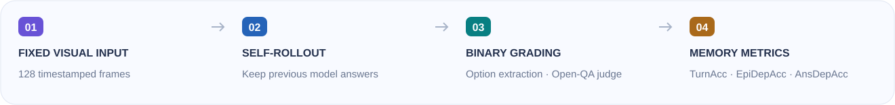

<div align="center">
  

  


[Overview](#overview) · [Evaluation](#evaluation) · [Protocol](docs/PROTOCOL.md) · [Data Format](docs/DATA_FORMAT.md) · [Results](#results) · [Citation](#citation)

</div>

---

## Overview

**VideoMemBench** evaluates in-context video memory in multi-turn video conversations.
Later questions depend on earlier turns through two types of links: **Episodic
Dependencies**, which revisit a previously discussed scene or entity, and **Answer
Dependencies**, which build on an earlier answer.

<p align="center">
  
</p>

Each model receives the same **128 timestamped frames**. Questions are presented
in dialogue order, with the model's own previous responses retained in the history.

## Results

Main results from Table 2. Models use 128 frames and self-rollout. The human
baseline has no fixed frame budget. Scores are percentages.

<p align="center">
  
</p>

<details>
<summary><b>Full results — 25 models</b></summary>
<br/>

<table>
<thead><tr><th align="left">Model</th><th align="center">Frames</th><th align="right">TurnAcc</th><th align="right">EpiDepAcc</th><th align="right">AnsDepAcc</th><th align="right">Overall ↑</th></tr></thead>
<tbody>
<tr><th colspan="6" align="left">Human baseline</th></tr>
<tr><td>&nbsp; Human</td><td align="center">—</td><td align="right"><b>88.1</b></td><td align="right"><b>86.0</b></td><td align="right"><b>84.2</b></td><td align="right"><b>86.1</b></td></tr>
<tr><th colspan="6" align="left">Closed-source models</th></tr>
<tr><td>&nbsp; Claude Opus 5</td><td align="center">128</td><td align="right"><b>52.3</b></td><td align="right"><b>49.1</b></td><td align="right"><b>35.7</b></td><td align="right"><b>45.7</b></td></tr>
<tr><td>&nbsp; Gemini 3.8 Flash</td><td align="center">128</td><td align="right">50.4</td><td align="right">46.6</td><td align="right">30.3</td><td align="right">42.4</td></tr>
<tr><td>&nbsp; GPT-5.6-sol</td><td align="center">128</td><td align="right">50.0</td><td align="right">47.8</td><td align="right">27.1</td><td align="right">41.7</td></tr>
<tr><td>&nbsp; Gemini 3.5 Flash</td><td align="center">128</td><td align="right">49.6</td><td align="right">45.5</td><td align="right">29.7</td><td align="right">41.6</td></tr>
<tr><td>&nbsp; GPT-5.5</td><td align="center">128</td><td align="right">48.0</td><td align="right">46.5</td><td align="right">27.0</td><td align="right">40.5</td></tr>
<tr><td>&nbsp; Claude Sonnet 5</td><td align="center">128</td><td align="right">47.8</td><td align="right">45.3</td><td align="right">27.3</td><td align="right">40.2</td></tr>
<tr><td>&nbsp; Gemini 3.1 Pro Preview</td><td align="center">128</td><td align="right">45.7</td><td align="right">44.8</td><td align="right">27.0</td><td align="right">39.1</td></tr>
<tr><td>&nbsp; GPT-5.4</td><td align="center">128</td><td align="right">44.4</td><td align="right">42.6</td><td align="right">21.9</td><td align="right">36.3</td></tr>
<tr><th colspan="6" align="left">Open-weight models</th></tr>
<tr><td>&nbsp; Kimi K3</td><td align="center">128</td><td align="right"><b>50.5</b></td><td align="right"><b>49.0</b></td><td align="right"><b>27.1</b></td><td align="right"><b>42.2</b></td></tr>
<tr><td>&nbsp; Qwen3-VL-235B-A22B</td><td align="center">128</td><td align="right">43.1</td><td align="right">41.6</td><td align="right">18.6</td><td align="right">34.4</td></tr>
<tr><td>&nbsp; Qwen3.5-27B</td><td align="center">128</td><td align="right">42.2</td><td align="right">39.8</td><td align="right">20.9</td><td align="right">34.3</td></tr>
<tr><td>&nbsp; Qwen3.5-397B-A17B</td><td align="center">128</td><td align="right">42.3</td><td align="right">40.1</td><td align="right">20.3</td><td align="right">34.2</td></tr>
<tr><td>&nbsp; Qwen3.5-122B-A10B</td><td align="center">128</td><td align="right">42.4</td><td align="right">39.5</td><td align="right">19.9</td><td align="right">33.9</td></tr>
<tr><td>&nbsp; Qwen3.5-35B-A3B</td><td align="center">128</td><td align="right">38.2</td><td align="right">36.3</td><td align="right">18.0</td><td align="right">30.8</td></tr>
<tr><td>&nbsp; Qwen3-VL-32B</td><td align="center">128</td><td align="right">39.3</td><td align="right">35.9</td><td align="right">17.2</td><td align="right">30.8</td></tr>
<tr><td>&nbsp; Qwen3-VL-30B-A3B</td><td align="center">128</td><td align="right">36.4</td><td align="right">35.1</td><td align="right">15.8</td><td align="right">29.1</td></tr>
<tr><td>&nbsp; Qwen3.5-9B</td><td align="center">128</td><td align="right">34.6</td><td align="right">33.4</td><td align="right">12.9</td><td align="right">27.0</td></tr>
<tr><td>&nbsp; Qwen3-VL-8B</td><td align="center">128</td><td align="right">34.8</td><td align="right">32.1</td><td align="right">12.3</td><td align="right">26.4</td></tr>
<tr><td>&nbsp; Qwen3.5-4B</td><td align="center">128</td><td align="right">33.8</td><td align="right">32.6</td><td align="right">12.5</td><td align="right">26.3</td></tr>
<tr><td>&nbsp; Qwen3-VL-4B</td><td align="center">128</td><td align="right">32.4</td><td align="right">29.4</td><td align="right">12.9</td><td align="right">24.9</td></tr>
<tr><td>&nbsp; Qwen2.5-VL-32B</td><td align="center">128</td><td align="right">31.7</td><td align="right">32.6</td><td align="right">9.6</td><td align="right">24.6</td></tr>
<tr><td>&nbsp; Qwen2.5-VL-7B</td><td align="center">128</td><td align="right">26.2</td><td align="right">24.9</td><td align="right">8.4</td><td align="right">19.8</td></tr>
<tr><td>&nbsp; Keye-VL-1.5-8B</td><td align="center">128</td><td align="right">25.4</td><td align="right">24.5</td><td align="right">8.2</td><td align="right">19.4</td></tr>
<tr><td>&nbsp; Qwen2.5-VL-3B</td><td align="center">128</td><td align="right">23.5</td><td align="right">24.4</td><td align="right">5.7</td><td align="right">17.9</td></tr>
<tr><td>&nbsp; Qwen3.5-0.8B</td><td align="center">128</td><td align="right">21.6</td><td align="right">21.3</td><td align="right">5.7</td><td align="right">16.2</td></tr>
</tbody>
</table>

</details>

## Evaluation

<p align="center">
  
</p>

### Installation

Python 3.11 or newer is required.

```bash
python -m venv .venv
source .venv/bin/activate
pip install -e .
```

### Data

Place annotations and videos under `data/`:

```text
data/
├── annotations.jsonl
└── videos/
    └── <video_name>.mp4
```

See [Data Format](docs/DATA_FORMAT.md) for the annotation schema.

### Prepare frames

```bash
python -m videomembench.data data/annotations.jsonl
python -m videomembench.video \
  --annotations data/annotations.jsonl \
  --video-root data/videos \
  --frame-cache cache/f128
```

Reuse the same frame cache across all models. The cache records frame indices,
timestamps, and checksums to keep visual input fixed.

### Run inference

Set model and judge endpoints in [`configs/evaluation.toml`](configs/evaluation.toml).
The main evaluation uses **GPT-5.4 mini** for open-answer grading. Set the model ID
exposed by your endpoint and provide credentials through environment variables:

```bash
export VMB_API_KEY="your-model-api-key"
export VMB_JUDGE_API_KEY="your-judge-api-key"

python -m inference.evaluate --config configs/evaluation.toml
```

For unauthenticated local endpoints, leave the corresponding key variable unset.
The vision endpoint must support 128 images and the complete dialogue history.
Use `--workers N` to evaluate videos concurrently; turns within each video remain
sequential. Repeating a run skips completed videos and retries failed dialogues.
Use a new output path when changing the model or evaluation settings.

### Compute scores

```bash
python -m inference.metrics \
  --annotations data/annotations.jsonl runs/my-model/eval.jsonl

python -m inference.metrics \
  --annotations data/annotations.jsonl \
  --format json runs/my-model/eval.jsonl > runs/my-model/metrics.json
```

Reports are available in Markdown, JSON, and CSV. Incomplete runs are rejected by
default. `--allow-incomplete` reports diagnostic scores with missing turns counted
as incorrect.

## Metrics

<table>
<thead><tr><th align="left">Metric</th><th align="left">Evaluation subset</th><th align="left">Credit rule</th></tr></thead>
<tbody>
<tr><td><b>①&nbsp;TurnAcc</b></td><td>All turns</td><td>Correct current response</td></tr>
<tr><td><b>②&nbsp;EpiDepAcc</b></td><td>≥1 Episodic parent</td><td>Correct current response; independent of parent correctness</td></tr>
<tr><td><b>③&nbsp;AnsDepAcc</b></td><td>≥1 Answer parent</td><td>Correct current response and all recursive Answer ancestors</td></tr>
<tr><td><b>Overall</b></td><td>Three complementary metrics</td><td><b>(① + ② + ③) / 3</b></td></tr>
</tbody>
</table>

Answer-ancestor traversal follows **Answer edges only**. Episodic edges are excluded
at every depth. A turn with both dependency types contributes to both subsets.
Scores are pooled across turns and reported as percentages.

See [Evaluation Protocol](docs/PROTOCOL.md) for frame sampling, response grading,
and metric definitions.

## Examples and Tests

The [example files](examples/) illustrate the annotation format and dependency
scoring. They are synthetic examples, not benchmark samples.

```bash
pip install -e ".[dev]"
python -m videomembench.data examples/annotations.jsonl
python -m inference.metrics \
  --annotations examples/annotations.jsonl examples/results.jsonl
python -m pytest
```

The example scores are TurnAcc **75.00**, EpiDepAcc **100.00**, AnsDepAcc **0.00**,
and Overall **58.33**.

## Citation

```bibtex
@unpublished{videomembench,
  title  = {VideoMemBench: How Well Do MLLMs Remember in Video Conversations?},
  author = {Hu, Zhengdong and Wang, Chao and Feng, Kaituo and Yao, Huanjin
            and Lu, Mingfei and Fan, Hehe and Yang, Yi},
  note   = {Manuscript}
}
```

## License

VideoMemBench is available for **academic, non-commercial research**. Commercial
use and redistribution require prior written permission. Copyright in source videos
remains with their respective owners. See [LICENSE](LICENSE) for the full terms.
